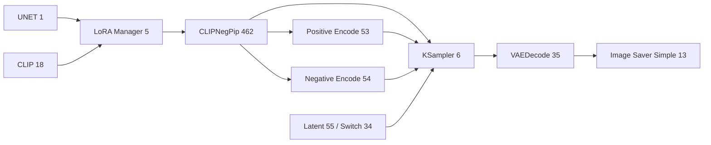

# 생성과 등록 Workflow 계약

## 확정 요구

새 구현은 **Comfy Home Server에 등록된 Workflow**를 사용합니다. Style Lab 전용 10-Node Workflow를 새 프로그램의 기본 생성 경로로 복제하지 않습니다. 기존 데이터 해석과 복원을 위해 해당 JSON은 Snapshot에 보관합니다.

Moss는 사용자가 추가할 예정인 모델입니다. 현재 조사한 Registry에는 `anima`, `minimax_h3`만 있습니다. Moss의 정확한 모델·Node·입출력 규약은 아직 확인하지 않았습니다. 특정 Architecture, 작가 태그 지원, Negative/CFG/LoRA 동작을 미리 단정하지 않습니다.

## 실제 Workflow 비교

| 항목 | 현재 Style Lab | Home Server 등록 Anima |
| --- | --- | --- |
| 원본 | `data/workflow.json`, 10 Nodes | `AnimaTurboV9/AnimaStandardTurboV9_empty_api.json`, 34 Nodes와 대응 UI JSON |
| 실제 모델 | `anima_turboV11.safetensors` | 같은 파일. 폴더명의 V9는 실제 모델 Version이 아님 |
| Text Encoder / VAE | Qwen 0.6B / Qwen Image VAE | 동일 파일명 |
| Prompt 입력 | Encode text 직접 변경 | Impact 고정 텍스트 입력과 중간 문자열 처리 경유 |
| LoRA | 동적 `LoraLoaderModelOnly` 체인 | 기존 LoRA Manager Node 5 항목 배열 |
| NegPip 순서 | 기본 NegPip 뒤, Sampler 앞에 동적 LoRA 삽입 | LoRA Manager → NegPip 462 → Encode/Sampler |
| 출력 | PreviewImage 수신 후 앱 폴더 저장 | Image Saver Simple 13 → Home 관리 Output |
| 모델 선택 | Custom Workflow Loader는 UI 선택으로 덮어쓰지 않음 | 등록 Template 기준. 범용 모델 변경 API가 이미 있는 것은 아님 |



Detector·Detailer용 Node가 정의돼 있어도 해당 생성에서 실행된다는 뜻은 아닙니다. 위 그림은 Saver로 이어지는 주요 경로입니다. 실제 입력 참조를 따라 실행 경로를 검증해야 합니다.

## Home Anima Adapter의 입력 위치

| 입력 | 현재 Node·처리 |
| --- | --- |
| Positive/Negative | 3/4의 `wildcard_text`, `populated_text`, `mode=fixed` |
| 실제 Encode | 53.text는40 출력, 54.text는4 출력 |
| Seed / Steps / CFG | 24의 `seed`, `steps`, `cfg` |
| Sampler / Scheduler | Template의24 → 27/26 → 6. 현재 `prepare_anima`는 설정으로 변경하지 않음 |
| Width / Height | 45.value / 48.value |
| Batch | 51.value = 1 |
| LoRA | 5.inputs.loras = `{ "__value__": [...] }` |
| Trigger | 43을 비활성화하고 비우는 기존 정책 |
| 출력 | 13.path / filename / time_format |
| PNG Workflow | API/UI JSON 모두 갱신, `extra_data.extra_pnginfo` 전달 |

LoRA 항목은 `name`, `strength`, `clipStrength`, `active` 등을 포함합니다. `text`만 변경하면 실제 선택이 반영되지 않습니다. CLIP 강도0은 API에서는 숫자0, UI Metadata에서는 기존 Adapter가 문자열 `"0"`으로 보정합니다. 현재 계약을 함께 보존해야 합니다.

Style Lab은 등록 Trigger를 Prompt에 자동 추가하지만 Home의 Anima Adapter는 자동 Trigger를 비활성화합니다. 새 기능의 Trigger 정책은 Project Revision에 저장하고 중복 삽입하지 않습니다.

## 고정 Seed의 함정

Home `_submit_requests`는 일반 Anima 요청의 `settings.seed`를 뒤에서 난수로 덮어씁니다. `prepare_anima`가 Seed를 받는 것과 일반 Batch API가 고정 Seed를 보장하는 것은 다릅니다. Favorite 복원용 Seed 경로를 Style 기능인 것처럼 위장해서 사용하지 않습니다.

새 생성 계약 예시:

```json
{
  "project_id": "project-example",
  "evaluation_revision_id": "evaluation-example",
  "workflow_revision_id": "registered-anima-example",
  "sampling_seed_policy": "fixed",
  "sampling_seed": 42,
  "prompt_resolution_policy": "frozen",
  "prompt_resolution_seed": 120,
  "candidate_component_set_id": "component-set-example"
}
```

Sampling Seed와 Tag/Wildcard 선택 Seed는 별개입니다. 비교에서는 Prompt 전개 결과도 고정해 후보마다 배경·캐릭터가 달라지지 않도록 합니다. 크기·Steps·CFG·Sampler/Scheduler·Denoise·입력 이미지·주요 후처리도 같은 평가 계약에 포함합니다.

## 모델별 Adapter

제안 `WorkflowDefinition`: `workflow_identifier`, `revision`, `model_family`, `output_kind`, `capabilities`, `input_bindings`, `output_bindings`, `template_hashes`, `adapter_version`.

- 평가 Engine은 구조화된 성분과 RenderPlan만 전달하며 Node ID와 `@artist` 문법을 알지 않습니다.
- Anima Adapter가 작가 변환·LoRA Manager·NegPip을 처리합니다.
- Moss는 Home에 등록한 생성 Adapter를 Style 기능에서도 재사용합니다.
- 작가 태그·LoRA·Negative·CFG·Seed 등의 지원을 Capabilities로 선언합니다. 미지원 설정을 동작하는 것처럼 표시하지 않습니다.
- 미등록 모델을 `else: MiniMax` 경로로 보내지 않고 거부합니다.

## Snapshot과 재현

Template는 요청별 Deep Copy합니다. API/UI Snapshot, Model Identifier와 가능하면 Hash, Adapter Version, 확정 Prompt, Seed, 성분 Weight를 기록합니다. 모델 Tensor 본체는 넣지 않습니다.

CFG 1의 일반 Negative conditioning과 NegPip의 Positive 음수 Weight는 다른 기능입니다. Anima 동작을 Moss에 자동 이식하거나 일반 Negative를 Positive 음수로 임의 변환하지 않습니다.
