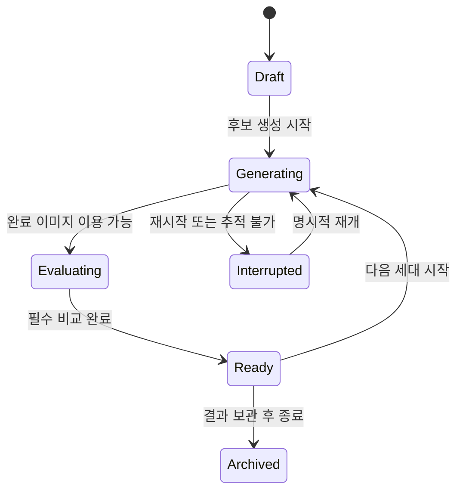

# 새 Domain·저장·API 계약안

여기의 테이블과 API는 **제안**이며 현재 Home Server에 구현된 것이 아닙니다.

글로벌 실행기·Endpoint·파이프라인/Catalog·STR 기본값과 프로젝트의 실제 선택·Prompt·범위 Snapshot은 [21번](21_project_context_settings_and_fork.md)의 경계로 분리합니다. 현재 프로젝트는 탭의 작업 맥락이며 요청에는 소유 Project/Evaluation/Match ID를 고정합니다. 그림체 필터 변경으로 요청 소속을 바꾸지 않습니다. 한 Match는 여러 Prompt의 같은 조합 A/B에 대한 한 표입니다.

2026-11-10의 [20번 확장](20_web_ux_fusion_multi_prompt_and_component_differences.md)에 따라 평가 계약에 Prompt Set Version·Case·투표/집계 정책을, Render에 Case/Seed 소속을 보존합니다. Match는 선택한 투표 정책에 맞는 결과 묶음을 가리키며 구성 Render의 조건·소유를 검증합니다. 여러 원본 융합의 비율·출처 Snapshot과 프로젝트 성분 제외 정책 Revision도 필요합니다. 아래는 초기 테이블 제안이며 실제 Schema는 각 기능 구현 전에 갱신합니다.

## Entity

| Entity | 주요 Field |
| --- | --- |
| `style_projects` | project_id, name, description, status, created_at, active_evaluation_id |
| `style_evaluation_revisions` | evaluation_id, project_id, 불변 generation_contract, workflow_revision_id, condition_hash |
| `style_project_components` | project_id, component_id, enabled, min/max_weight, compatibility_state |
| `style_component_priors` | evaluation_id, component_id, initial_score, transfer_strength, source/provenance |
| `style_component_statistics` | evaluation_id, component_id, estimated_score, observed_count, 사용·승패, algorithm_version |
| `style_candidates` | candidate_id, evaluation_id, component_set_json, fingerprint, elo, matches, wins, placed, generation_id, status |
| `style_lineages` | lineage_id, evaluation_id, 이름·목적, 대표 후보·정책 Revision |
| `style_lineage_memberships` | lineage_id, candidate_id, 소속·대표 역할, 출처·Event Sequence |
| `style_candidate_renders` | render_id, candidate_id, request_id, output_id, sampling_seed, contract_snapshot_hash, status |
| `style_generations` | generation_id, evaluation_id, number, frozen_parent_scores, frozen_lock_policy_revision, status, summary |
| `style_generation_checkpoints` | checkpoint_id, evaluation_id, generation_id, event_sequence, 불변 상태 Snapshot, Asset Manifest, integrity_hash |
| `style_generation_restore_operations` | operation_id, checkpoint_id, expected_timeline_revision, 삭제 Manifest, idempotency_key, 처리 상태 |
| `style_matches` | match_id, evaluation_id, generation_id, revision, a/b candidate/render, kind, status |
| `style_vote_events` | vote_id, match_id, project/evaluation, idempotency_key, result, before/after, undone_by, event_sequence |
| `style_saved_styles` | saved_style_id, project_id, 불변 성분·조건 Snapshot, render 참조, name, memo |
| `style_operation_events` | operation_id, project/evaluation, request/generation, 상태, 오류·안내 |
| `style_prompt_retest_sessions` | trial_id, source_evaluation/generation/event/timeline, trial_evaluation_id, 조건 Snapshot, 상태 |
| `style_prompt_retest_entries` | trial_id, source/trial candidate_id, 원본 성분 Fingerprint·순위, 제외 상태 |
| `style_component_lock_policies` | policy_id, project/lineage, revision, 성분 Identity·Hash·순서, 고정 Weight 축·값 |
| `style_project_branch_snapshots` | branch_id, source Project/Evaluation/Checkpoint/Event, target_project_id, 불변 출처 Snapshot, ID 대응·Asset 참조 |
| `style_ablation_experiments` | experiment_id, source Snapshot, diagnostic_evaluation_id, Baseline·변형 Delta, RenderPlan·상태 |
| `style_validation_suites` | suite_id, version, Case 정의·공통 Seed, 불변 조건·출처 |
| `style_validation_runs` | run_id, source Snapshot, suite_version, 선택 후보·계획·Asset Manifest·상태 |
| `style_validation_case_results` | run/case, validation_evaluation_id, 원본/평가 후보 대응, Render·수동 판정·Memo |
| `style_pair_recommendation_policies` | policy_id, version, 적격 범위·가중치·Cooldown·필수 대결 우선 규칙 |

## 불변 조건과 저장

모든 참조가 같은 Project/Evaluation 소속인지 검사합니다. 단일 Column 외래키만으로 프로젝트 간 잘못된 연결이 막히지는 않으므로 복합 제약이나 Service 검증을 적용합니다.

Candidate의 성분은 생성 후 불변입니다. Weight 조정은 새 Candidate를 만들며 기존 Elo의 의미를 바꾸지 않습니다. Render를 Candidate와 분리해 여러 Seed를 지원합니다. 실패한 Render는 Vote 대상이 아닙니다.

Prompt 재시험은 별도 Trial Evaluation의 Candidate·Render·Match를 사용합니다. 성분은 원본과 같고 Elo는 10000/전적0부터 시작합니다. Trial 테이블에 점수를 중복 저장하지 않습니다. 채택 전 Drop은 시험 한정이며 원본 순위와 세대는 바뀌지 않습니다. [17번 문서](17_prompt_retests_and_reranking.md)에 선택·채택·동시성 계약을 정의합니다.

Evaluation에 `purpose`와 소유 Operation/Run을 기록해 일반 탐색·Prompt 재시험·Ablation·Validation Case를 구분합니다. 진단·검증도 기존 Candidate/Render/Match/Vote 구조를 재사용하며 조건별 평가와 원본 통계를 섞지 않습니다. 분기는 새 Project와 소유 ID를 만들고 출처 통계를 불변 기준값으로 보존합니다. 잠금은 기존 Candidate 수정이 아니라 이후 생성 계획에 적용합니다. 상세 불변식은 [19번 문서](19_adopted_exploration_tools.md)를 따릅니다.

평가 구간마다 `timeline_revision`을 두고 세대 복원 시 갱신합니다. 세대 번호 필터로만 삭제하지 않고 Checkpoint의 Event 경계와 상태 전체를 복원합니다. 상세 계약은 [15번 문서](15_generation_restore_and_deletion.md)를 따릅니다.

Home 내장 시 기존 SQLite Migration 또는 별도DB를 선택할 수 있지만 Vote·순위·세대의 원자적 변경을 분산 저장하지 않습니다. 조사 시점 Home Schema는14입니다. 실제 구현 시 최신 Version에서 Migration 번호를 채번합니다.

## 상태 흐름



프로젝트 표시 상태의 개략도입니다. 개별 Job·세대·Render·Match에는 각자의 상태가 필요합니다. 생성 중 완료된 후보를 먼저 비교할 수 있으므로 내부 상태를 하나의 Enum에 압축하지 않습니다.

## API안

| Method | Path | 역할 |
| --- | --- | --- |
| GET/POST | `/api/style-projects` | 목록/생성 |
| GET/PATCH | `/api/style-projects/{project_id}` | 상세/표시 설정 |
| POST | `.../{project_id}/evaluation-revisions` | 새 평가 조건 |
| POST | `.../{project_id}/score-snapshots` | 이전용 불변 점수 Snapshot |
| POST | `.../{project_id}/candidate-batches` | 초기 후보 생성 |
| GET/POST | `.../{project_id}/component-lock-policies` | 프로젝트/계보 잠금 조회·정책 Revision 생성 |
| POST | `.../{project_id}/branches/preview` | 현재 안정 상태·Checkpoint의 분기 영향 확인 |
| POST | `.../{project_id}/branches` | 새 Project Snapshot 분기 |
| POST | `.../{project_id}/ablation-experiments` | 고정 조건 Baseline·변형 계획 생성 |
| POST | `.../{project_id}/ablation-experiments/{experiment_id}/renders` | 계획 확인 후 진단 생성 |
| POST | `.../{project_id}/ablation-experiments/{experiment_id}/candidates` | 제약 확인 후 변형을 새 후보로 가져오기 |
| GET/POST | `.../{project_id}/validation-suites` | 검증 Case·Seed 정의와 Version 관리 |
| POST | `.../{project_id}/validation-runs` | 후보·Suite Version 고정, 장수 Preview 계획 |
| POST | `.../{project_id}/validation-runs/{run_id}/renders` | 확인한 검증 계획 제출 |
| POST | `.../{project_id}/prompt-retests` | 상위 N개 고정 조합의 새 Prompt 시험 |
| POST | `.../{project_id}/prompt-retests/{trial_id}/renders` | 시험 이미지 생성·실패 재시도 |
| POST | `.../{project_id}/prompt-retests/{trial_id}/candidates/{candidate_id}/drop` | 시험에서 제외; reinstate로 취소 |
| POST | `.../{project_id}/prompt-retests/{trial_id}/adopt` | 남은 조합과 새 조건을 활성 평가 구간으로 채택 |
| GET | `.../{project_id}/matches/current` | Revision Token 포함 Pair |
| POST | `.../{project_id}/votes` | 승패/비슷함 |
| POST | `.../{project_id}/votes/{vote_id}/undo` | 특정 Vote 취소 |
| POST | `.../{project_id}/generations` | 다음 세대 후보 생성 |
| POST | `.../{project_id}/generations/{generation_id}/finalize` | 세대 확정 |
| POST | `.../{project_id}/generations/{generation_id}/restore-preview` | 복원 대상·삭제 영향 미리보기 |
| POST | `.../{project_id}/generations/{generation_id}/restore` | 확인 Token 검증 후 복원·삭제 |
| GET | `.../{project_id}/restore-operations/{operation_id}` | 복원·파일 정리 상태 |
| GET | `.../{project_id}/candidates` | 후보 조회 |
| POST | `.../{project_id}/saved-styles` | 다수 결과 저장 |
| POST | `.../{project_id}/export` | Project Bundle |
| POST | `/api/style-project-imports/preview` | 비변경 Import 미리보기 |

Home 기존 API와 명명 공간을 분리합니다. 인증·CSRF·출력 조회 보호는 Home의 것을 재사용하며 별도 Password를 코드에 넣지 않습니다.

### Vote 예시

```json
{
  "evaluation_revision_id": "evaluation-example",
  "match_id": "match-example",
  "expected_match_revision": 7,
  "expected_a_render_id": "render-a",
  "expected_b_render_id": "render-b",
  "result": "a",
  "idempotency_key": "unique-request-token"
}
```

화면의 좌우가 아니라 의미상 A/B를 선택합니다. result는 `a|b|similar`이며 similar를 Match Kind별 기존 의미로 처리합니다.

트랜잭션 안에서 Match·Revision을 검사하고 같은 Idempotency Key에는 같은 응답을 반환합니다. 별도의 오래된 요청은409입니다. 같은 Pair가 다시 나와도 과거 Token은 사용할 수 없습니다. Undo는 Vote·통계·순위·다음 Pair를 함께 갱신합니다.

Match에는 추천 정책 Version·추천 이유·후보 집합 Snapshot을 기록합니다. 추천은 기존 필수 대결을 대체하지 않으며 Pair 선정만 바꿉니다. Validation Pair는 같은 Case·Seed·Evaluation 소속을 검사하고 다른 조건의 이미지를 연결하지 않습니다.

Trial Vote에는 `trial_id`와 Trial의 `evaluation_revision_id`를 함께 검증합니다. Drop·Undo·채택과 투표가 경쟁할 때도 같은 평가 구간 안에서 원자적으로 처리합니다. 다른 Trial 또는 원본 이미지와의 Pair는 거부합니다.

## Job과 중단

작업·출력의 생성 출처, Project 소유와 관리 경로는 [22번](22_style_job_output_separation_and_project_rename.md)을 따릅니다. 메모는 세대부터 작성하고 프로젝트 Rename 시 폴더·분류명과 실제 파일 참조를 함께 갱신합니다. 스타일 구성 Job의 분류 변경·출력 이동은 서버에서도 금지하며 관리 Rename은 별도 Operation으로 복구 가능하게 처리합니다.

모든 생성 요청에 Project/Evaluation/Generation/Candidate/Render 소속을 기록합니다. Browser를 닫아도 Home 감시가 추적합니다. 기동 시 미완료 요청을 발견해도 자동 재제출하지 않고 ComfyUI prompt_id/History와 대조합니다. 확정하지 못하면 Interrupted/Unknown으로 남깁니다.

취소는 프로젝트가 소유한 Request ID에 한정합니다. 다른 프로젝트나 일반 생성까지 전체 Interrupt하지 않습니다. HTTP Timeout도 생성 실패 확정으로 간주하지 않고 재접속 후 확인합니다.
