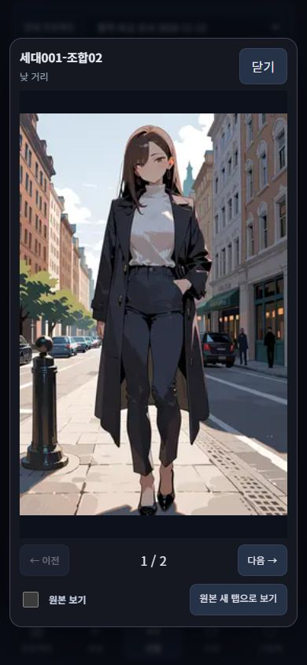
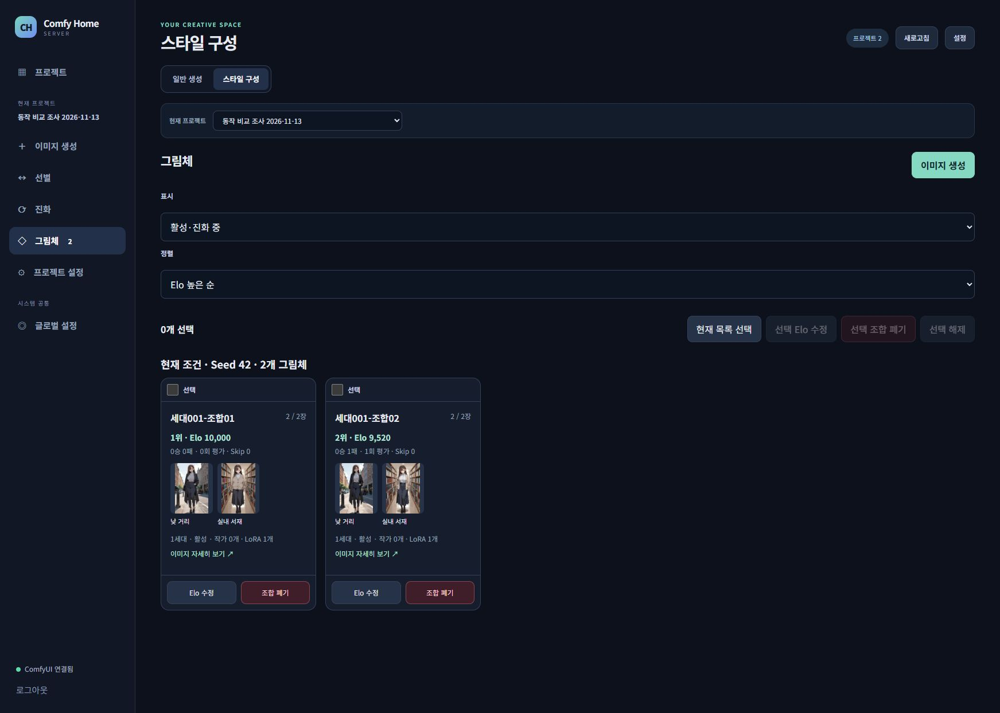

# 재현한 문제와 실제 차이

앱은 현재 두 서비스 모두 생성·선별·세대 확정을 수행할 수 있습니다. 문제는 최소 Cycle이 전혀 없는 것이 아니라, **선별 정책과 조작 경험을 원본과 같은 것으로 보기 어려운 부분이 남아 있다는 점**입니다. 프로젝트와 다중 Prompt 확장은 동작했고 유지해야 합니다.

## 1. 재현된 결함: Blind 확대 시 식별 정보 노출

CHS에서 Blind를 켜면 A/B 이름은 `그림체 숨김`으로 바뀝니다. 같은 상태에서 이미지를 누르면 Viewer 제목이 `세대001-조합02`이고, 원본 링크 Tooltip에도 같은 파일 이름이 나옵니다. 실제 후보가 누구인지 가리는 목적이 큰 보기에서 이어지지 않습니다.

원본 Arena의 Blind Lightbox는 실제로 이미지 외 텍스트가 없었습니다. 다만 이 Lightbox는 AX Tree에 나타나지 않아 Screenshot과 DOM으로 확인했습니다. CHS의 이름 노출은 큰 보기 공간을 넓혔는지와 별도의 문제입니다.

## 2. 실제 UI 문제: 그림체를 보려는데 이미지가 한참 아래에 작게 나옵니다

같은 기본 Viewport 1743×1244에서 설치본 Gallery 첫 Thumbnail의 상단은 약236px, 크기는 약126×184px였습니다. CHS 조사 프로젝트는 상단 약808px, Thumbnail 약74×88px였습니다. CHS의 글로벌 Header·작업 공간 전환·프로젝트 Context·세로 Filter·Bulk Toolbar·카드 통계가 먼저 배치됩니다.

원본은 Gallery 한 번 선택으로 옆의 큰 Preview를 바꿉니다. CHS는 한 번 누르면 Modal을 열고, Bulk 선택은 별도 Checkbox입니다. 원본과 똑같은 구조를 반드시 써야 한다는 뜻은 아니지만, 추가 기능을 유지하면서도 이미지가 차지하는 공간은 다시 설계할 필요가 있습니다.

수치는 이번 프로젝트와 배치의 관찰값이며 모든 해상도·Prompt 수에 일반화하지 않습니다. Mobile에서는 양쪽의 나란히·한 장씩 전환을 확인했습니다. CHS 큰 보기 자체는 남은 화면 높이를 사용했고, 이미지 관련 버튼만 남아 있었습니다.

## 3. 선별이 길게 느껴지는 이유에는 실제 정책 차이가 있습니다

원본 133세대는 부모 6개 중 최하위 부모에게 새 자녀가 한 번 지자 탈락으로 정리됐습니다. CHS 3세대는 부모 3개를 뽑았지만 비교 기준은 전체 기존 Pool 10개였고, 자녀가 기존 후보에게 네 번 진 뒤 종료했습니다. 원본 134세대도 패배 한 번으로 끝났습니다.

두 서비스의 기존 상태는 다르므로 이 횟수만으로 성능·정확도를 비교하지 않습니다. 다만 동일한 합성 입력에서도 부모 Ladder와 전체 Ladder의 차이가 나왔고, [현재 Source](01-source-comparison.md)가 실제 차이를 설명합니다. 전체 Ladder는 과거에 의도적으로 추가됐다는 기록이 있어 단순 Bug로 되돌릴 항목과 구분합니다.

원본의 독립 Random 신규 조합은 이번 실제 실행에서 전체 순위표 배치 5표를 요구했습니다. 즉 **원본도 Random 신규 배치와 진화 자녀의 빠른 생존 판정이 다릅니다.** 두 종류를 합쳐 원본의 모든 신규 조합이 한 표로 끝난다고 설명하면 틀립니다.

## 4. 생성의 선택권·선별 피드백이 다릅니다

- 원본은 조합 메뉴의 만들기로 기존 Pool에 무작위 후보를 별도로 추가합니다. 실제 1장을 생성하고 신규 배치를 완료했습니다. CHS의 주 후보 생성은 Pool이 준비되면 진화로 전환됩니다.
- 원본은 자동·전체 리그·상위 30%를 직접 선택합니다. 실제로 신규 배치 중에도 일반/상위 리그로 이동했고, 자동으로 되돌리면 배치를 이어갔습니다. CHS에는 해당 모드 선택이 없습니다.
- 원본은 선택한 쪽 강조, 상대 흐림, 점수 변화·`+0` 공개 후 다음 Pair로 넘어갑니다. CHS는 서버 응답 후 영역을 교체합니다. 두 제품의 체감 차이는 버튼 색상만의 문제가 아닙니다.
- 원본은 Backspace Undo가 동작했습니다. CHS는 같은 입력으로 Pair가 바뀌지 않았고 화면 Undo 버튼을 눌러야 복원됐습니다. CHS Viewer의 방향키는 Prompt 탐색으로 정상 동작하는 별도 기능입니다.

## 5. 세대·취소·퇴역의 의미도 다릅니다

CHS는 마지막 확정 번호를 `현재 3세대`, 다음을 `4세대 후보`로 표현합니다. 원본은 134세대를 확정한 뒤 화면이 `현재 135세대`로 바뀝니다. 같은 숫자라 해서 같은 상태가 아닙니다.

원본 취소 경고는 이번 자녀와 선별 기록 삭제를 안내합니다. CHS는 이미지·작업 보존과 부모 평가 복귀를 안내합니다. CHS에서는 GPU에 제출하지 않은 4세대 계획을 취소해 확정 3세대로 복귀했고, 그 계획의 Job 수는 0이었습니다. 원본의 불가역 삭제는 실행하지 않았으므로 실제 파일 삭제 결과까지 재현했다고 주장하지 않습니다.

원본 활성 후보에는 북마크 15개가 있었습니다. 북마크 보호가 퇴역 결과에 영향을 주므로 점수가 높은 기존 후보가 제외됐다는 화면만으로 오류라고 단정하지 않았습니다. CHS에는 대응하는 보관 보호가 아직 연결되지 않았습니다.

## 6. 유지할 동작과 범위 밖 기능

CHS에서 새 독립 프로젝트를 만들어 2개 Prompt·2개 조합을 생성하고, 기존 프로젝트와 왕복한 뒤 Reload했습니다. 새 프로젝트의 네 이미지 경로와 기존 프로젝트의 세 Prompt·3세대 상태가 분리됐습니다. 비슷함→Undo에서도 기존 프로젝트의 여섯 A/B 이미지가 함께 복원됐습니다.

현재 운영 CHS의 세대 확정과 다음 생성은 이미 명시적으로 분리돼 있습니다. Elo·폐기 버튼을 제거한 큰 보기와 원본/Cache 전환도 실제 동작했습니다. 이들은 미완성 목록에 다시 넣지 않습니다.

원본에서 두 세대 연속 전멸 후 융합·다듬기 안내가 켜졌지만 이번 최소 범위에서는 제외합니다. 원본의 `99세대` 표시 상한, AX에서 보이지 않는 Lightbox, 즉시 Reload 전 저장 유실 등도 조사 중 관찰한 원본의 한계이며 그대로 복제할 기준이 아닙니다.

후속 작업의 대상 파일과 완료 조건은 [실행 계획](03-action-plan.md)에 있습니다.
